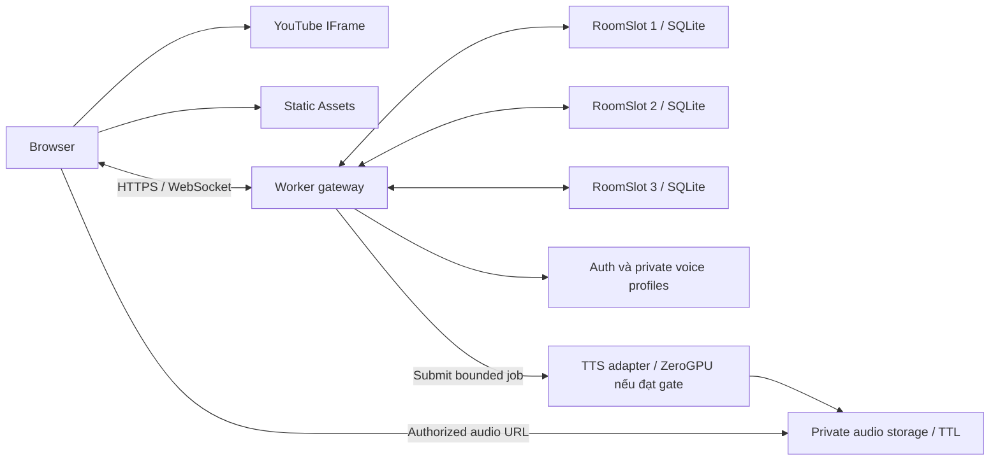

# Stack và kiến trúc v2 — cloud miễn phí, không có máy server

> **V3 supersedes,02/11/2026:** [Đặc tả hiện hành](THIET_KE_RAP_3D_V3.md): rạp3D, host chọn2–10ghế,3phòng/tối đa30người; playlist và approval/kick trong MVP. Các mức50/150, lựa chọn2D-only và timeline cũ bên dưới là baseline lịch sử, không phải yêu cầu mới. Budget/quality/security còn áp dụng khi không xung đột; xem v3 để biết luồng, số liệu và timeline thay thế.

Cập nhật 01/11/2026. Đây là quyết định thiết kế; chưa có implementation/deployment hay benchmark.

## 1. Stack đề xuất

| Lớp | Chọn | Vai trò và lý do |
|---|---|---|
| UI | React + TypeScript + Vite | SPA responsive, không cần SSR; player tách khỏi chat |
| Style | CSS/Tailwind, component accessible | Ít animation, nhẹ trên điện thoại |
| State client | Store theo feature, selector nhỏ | Chat thay đổi không render lại player |
| Hosting frontend | Cloudflare Workers Static Assets | Static routing trước Worker, dùng workers.dev, không mua domain |
| HTTP API | Cloudflare Worker + schema validation | Cấp session, danh sách phòng, điều phối TTS |
| Realtime | WebSocket native + Hibernation API | Bỏ Socket.IO server thường trực và polling liên tục |
| Room coordinator | 1 SQLite-backed Durable Object/slot | Tuần tự hóa thay đổi trong phòng, admission 50 thành viên |
| Room data | SQLite ngay trong Durable Object | State, membership, chat giới hạn, lệnh idempotent |
| Identity/profile | Supabase Free Auth + Postgres, có điều kiện quota | Tài khoản người muốn lưu giọng; guest session riêng cho khách |
| Reference/audio | Supabase Free private Storage | Quyền owner/member và TTL; audio egress có ngân sách |
| TTS engine | VieNeu v3 Turbo; Nano đối chứng | Tiếng Việt, cloning và preset; chưa chốt engine trước spike |
| TTS hosting | ZeroGPU Space do chủ dự án sở hữu, nếu đủ điều kiện | Nhánh cần kiểm chứng; không coi tài nguyên miễn phí là vô hạn |
| TTS fallback | Web Speech API tại thiết bị | Không tiêu thụ inference; không bảo đảm nam/nữ tiếng Việt hay giống giọng |
| Kiểm thử | Vitest, Workers test pool, Playwright, native WS load harness | Test logic, hibernation, UI, capacity và quota |
| Build/release | Lockfile, Wrangler config, CI phù hợp free quota | Pin dependency/model; staging và production tách namespace |

Không thêm WebRTC, LiveKit, TURN, Redis, Kubernetes, transcoding, virtual browser, AI agent hoặc LLM chat. Supabase chỉ phục vụ tài khoản/profile/file ở nhánh giọng; không nằm trên critical path của mỗi sự kiện video.

## 2. Topology



Mỗi room chỉ gửi metadata/state/chat, không relay video. 150 người xem không tạo 150 luồng video qua Worker. Mic chỉ xuất hiện trong luồng thu mẫu giọng.

### Ba room slot cố định

Giữ đúng ba object có tên xác định: `slot-1`, `slot-2`, `slot-3`. “Tạo phòng” nghĩa là claim slot rỗng và bắt đầu roomSessionId mới. Khách không được tự tạo DO từ roomId tùy ý. Không cần registry/global actor cho mọi tin nhắn.

Mỗi slot tự giao dịch admission/state. Nếu nhiều yêu cầu tạo cùng slot, chỉ một được nhận; UI trả về slot khác hoặc báo hết chỗ. Lobby lấy status của ba slot, cache ngắn khoảng 10 giây; không phải nguồn kiểm tra seat chính xác.

Closed/empty room có cơ chế release sau grace period; host có thể đóng ngay. Dùng session epoch để lệnh/link cũ không tác động phiên chiếu mới trong cùng slot. Link mời có roomSessionId và mã đủ entropy nếu dùng phòng riêng.

### Membership và 50 chỗ

- Server cấp credential guest ngẫu nhiên, không tin clientId tự khai; ưu tiên cookie Secure/HttpOnly cùng origin cho session.
- Join xác thực trước upgrade; admission tuần tự, transaction không await network ở giữa các bước kiểm tra/cấp seat.
- Một membership tối đa một kết nối active; tab mới takeover kết nối cũ. Danh tính guest là phiên, không phải xác minh người thật.
- Grace reconnect 30 giây; leave chủ động giải phóng ngay; hết grace phải admission lại.
- Lưu attachment tối thiểu trên socket để phục hồi sau hibernation; lấy danh sách socket thực từ runtime. Lưu state quan trọng trước khi broadcast.
- Host rời: giữ 30 giây; chuyển moderator được chỉ định. Nếu không có, khóa điều khiển, tiếp tục timeline; không tự trao host cho khách bất kỳ.
- Một alarm/DO quản lý deadline gần nhất: lease expiry, host transfer, queue timeout và retention. Không tạo interval nền giữ DO thức.

## 3. Đồng bộ playback

```ts
type PlaybackState = {
  roomSessionId: string;
  videoId: string | null;
  generation: number;
  revision: number;
  status: 'idle' | 'playing' | 'paused' | 'ended';
  anchorPositionSec: number;
  anchorServerTimeMs: number;
  rate: 1;
};
```

Khi playing: `target = anchorPositionSec + (estimatedServerNow - anchorServerTimeMs)/1000`. Client đo offset bằng ping/pong lúc vào, reconnect và khi foreground trở lại; sample thưa có jitter sau đó. Không phát “currentTime” mỗi frame.

Host command có commandId, expectedRevision, generation, roomSessionId. Server kiểm tra role và giá trị hữu hạn, lưu kết quả idempotent rồi ACK/broadcast. Stale command bị reject kèm snapshot; không replay lệnh cũ khi offline. Đổi video tăng generation, hủy callback cũ.

Client kiểm tra drift local khoảng 2 giây/lần. Bỏ qua <0,5s; quan sát 0,5–1,5s; chỉ seek nếu >1,5s kéo dài và hết cooldown 5s. Các ngưỡng là điểm bắt đầu benchmark, không bảo đảm mọi video. Không ép rate 1,03x vì YouTube không có rate tùy ý.

Nhận state theo sự kiện; snapshot khi join/reconnect/gap hoặc người dùng yêu cầu. Không giữ timer server snapshot 5 giây như bản v1. Nếu cần checkpoint, chỉ client điều phối gửi thưa và phải đo ảnh hưởng hibernation/quota.

Local buffering/autoplay block không pause cả phòng. Người lag có nút theo lại phòng. Viewer chỉnh volume/quality riêng; thao tác player riêng không được phát thành lệnh chung. Không che/chặn chức năng player YouTube.

Hibernation không làm timeline paused: phục hồi anchor rồi ngoại suy bình thường. Deploy/restart cũng phục hồi từ state đã commit; host có thể pause nếu có lỗi. Chỉ genuine session reset mới tạo epoch mới.

## 4. Chat và TTS

### Chat

- Tin chữ ACK sau lưu, clientMessageId unique theo membership/session để chống gửi trùng.
- Text ≤500 Unicode code points sau NFC, mỗi user ≤5 tin/10 giây; thêm ngân sách ngày mỗi phòng, không chỉ rate limit theo IP.
- Initial history 50 tin; DOM ≤200 tin; cursor tải thêm nếu còn retention.
- Lưu tối đa 500 tin/phòng hoặc 7 ngày, tùy điều kiện đến trước. Xóa theo batch nhỏ, tính cả delete/index vào quota write.
- Kick/ban/xóa tin ở server; tombstone event tới client; text render an toàn.

### Giọng cá nhân

Đăng nhập → đồng ý dùng giọng của chính mình → thu câu mẫu 10–15s → chuẩn hóa định dạng → kiểm tra audio → chọn đoạn theo model → sinh câu thử → người dùng duyệt → activate profile. Profile chỉ dùng cho tin của owner. Mic không mở trong phòng và không stream cho người khác.

Reference lưu private; server mới được đọc cho inference. Profile có owner, version, model revision, consentAt, deletion status. Xóa profile hủy job/cached embedding/audio liên quan theo chính sách; không thể thu hồi file người nghe đã tải.

### Luồng job đề xuất

1. Gửi chat chữ trước; yêu cầu TTS đi kèm hoặc bằng nút “Gửi và đọc”.
2. Room actor cấp job ID và reserve quota nguyên tử; kiểm tra queue và quyền giọng.
3. Worker gateway submit qua provider adapter có timeout, không giữ DO chờ inference. State `queued → submitted → ready/failed/expired/cancelled`.
4. Với Gradio/ZeroGPU cần thử submit/poll thật: dùng event/job ID nếu có; chỉ một bộ poll cho cả job, backoff giới hạn và persist để resume. Không dùng 50 client poll. Không coi `waitUntil` là worker chạy vô hạn.
5. Hoàn tất phải kiểm tra signature/job lease/epoch và idempotency, upload clip một lần, cập nhật duration + checksum.
6. Room xếp lịch `startsAt` cho audio ready; mỗi client preload và phát cùng clip. Người tắt TTS không tải audio.
7. Timeout/provider hết quota: tin chữ vẫn hiện; TTS báo lỗi hoặc fallback preset theo lựa chọn. Không tự tính phí hay sinh lại vô hạn.

Queue mỗi phòng ≤5 tin và ≤30s chờ; mỗi tin TTS đề xuất ≤120 Unicode code points sau NFC, clip ≤10s. Quota ngày còn quan trọng hơn các giới hạn này. Một phòng chỉ đọc một tin tại một thời điểm. Room đóng/session đổi thì cancel job. Token URL phải còn đủ thời gian tới lượt phát; cấp lại sau auth khi cần.

TTS local fallback không đáp ứng giọng cá nhân, không bảo đảm cùng giọng/cùng thời điểm trên mọi máy. UI phải ghi rõ. Chỉ khi provider vượt gate mới bật cặp preset đồng nhất và cloning cho bản đầy đủ.

## 5. Dữ liệu và API

**SQLite của Room DO:** room_session, playback_state, membership, message, processed_command, tts_job, audio_queue, budget_day. Khóa/index theo session, actor, idempotency key; transaction cho admission và reservation. Schema migration khi deploy có version; không chạy DDL mỗi request.

**Supabase:** voice_profiles, voice_consent, account preferences, private reference/audio metadata. RLS theo owner; private Storage; service secret chỉ server. Người nghe chỉ được cấp audio của phòng đang tham gia, không được đọc sample gốc. Không dùng user-editable metadata để xác định host/admin.

HTTP: `GET /api/rooms`, `POST /api/session`, `POST /api/rooms/:slot/create`, `POST /api/rooms/:slot/join`, `POST /api/rooms/:slot/leave`, `POST /api/rooms/:slot/close`, `POST /api/voice/enroll`, `POST /api/voice/preview`, `DELETE /api/voice`, `GET /api/audio/:id`.

WebSocket: `resume`, `clock:ping`, `playback:command`, `chat:send`, `tts:request`, `moderation:command` → `snapshot`, `playback:state`, `members:delta`, `chat:message`, `chat:deleted`, `tts:status`, `tts:scheduled`, `ack`, `room:closed`.

Mọi event có schema/version và limit payload (đề xuất 4 KB, upload audio qua HTTP riêng). Origin check; room epoch; quyền server-side. Error codes: ROOM_FULL, SLOT_BUSY, SESSION_EXPIRED, FORBIDDEN, STALE_REVISION, RATE_LIMITED, TTS_UNAVAILABLE, QUOTA_EXHAUSTED.

## 6. Tổ chức source

```text
apps/web/src/features/{lobby,room,player,chat,voice-profile,tts}
apps/worker/src/{gateway,room-slot,session,tts-adapter,quota}
packages/protocol/       # schema + error codes
packages/sync-core/      # pure timeline + revision logic
tts-space/              # Gradio/model adapter, chỉ triển khai khi đạt gate
tests/{unit,integration,e2e,load}
docs/{architecture,adr,runbooks,benchmarks}
wrangler.jsonc
```

Test harness chuyển từ Socket.IO trong kế hoạch v1 sang WebSocket native. Không đưa inference vào Cloudflare Worker vì workload không phù hợp giới hạn CPU/RAM.

## 7. Nguồn quyết định

- [Cloudflare DO WebSockets](https://developers.cloudflare.com/durable-objects/best-practices/websockets/): ưu tiên Hibernation API, attachment phục hồi socket.
- [DO pricing](https://developers.cloudflare.com/durable-objects/platform/pricing/): Free hỗ trợ SQLite-backed DO; quota compute/storage riêng.
- [Static assets billing](https://developers.cloudflare.com/workers/static-assets/billing-and-limitations/): asset requests miễn phí, routing vào Worker tiêu quota riêng.
- [Supabase pricing](https://supabase.com/pricing): Free có quota file/DB/egress, không phải storage phân phối audio vô hạn.
- [HF Spaces Overview](https://huggingface.co/docs/hub/spaces-overview), [ZeroGPU](https://huggingface.co/docs/hub/spaces-zerogpu): điều kiện tạo Space và daily GPU quota phải xác minh trên tài khoản.
- [VieNeu-TTS](https://github.com/pnnbao97/VieNeu-TTS): engine ứng viên, không đồng nghĩa dịch vụ hosted miễn phí đã sẵn sàng.

## Bổ sung adapter NVIDIA NIM

Thêm adapter NIM cho môi trường đánh giá nội bộ, dùng secret server-side, discovery locale/voice và contract version trước inference. Không đưa API trial hoặc audio trial vào production. Chi tiết [gate và protocol thử](NVIDIA_NIM_NGHIEN_CUU_VA_KE_HOACH_KIEM_THU.md). HTTP offline WAV là đường smoke ban đầu; streaming PCM/gRPC là hạng mục chưa thực hiện. Không mặc định Multilingual endpoint hỗ trợ cloning.

## Quyết định review02/11/2026

[Bảo mật/vận hành](BAO_MAT_VA_VAN_HANH.md) quy định session/CSRF/Origin, upload PCM và TTL. Signed audio URL là bearer capability sống tối đa60s; revoke chặn cấp URL mới, không thu hồi bản đã tải. Room riêng mặc định là đề xuất thiết kế hiện hành. [UI/UX](UI_UX_VA_TAI_NGUYEN.md) quy định trạng thái và giới hạn dùng chung với server.

### Bổ sung mới nhất

[Kế hoạch đồ họa và công nghệ3D](DO_HOA_VA_CONG_NGHE_RAP_3D.md) cập nhật bố cục, asset pipeline, latejoin không chờ và timeline. Host một mình phát được;2chỉ là capacity nhỏ nhất.
