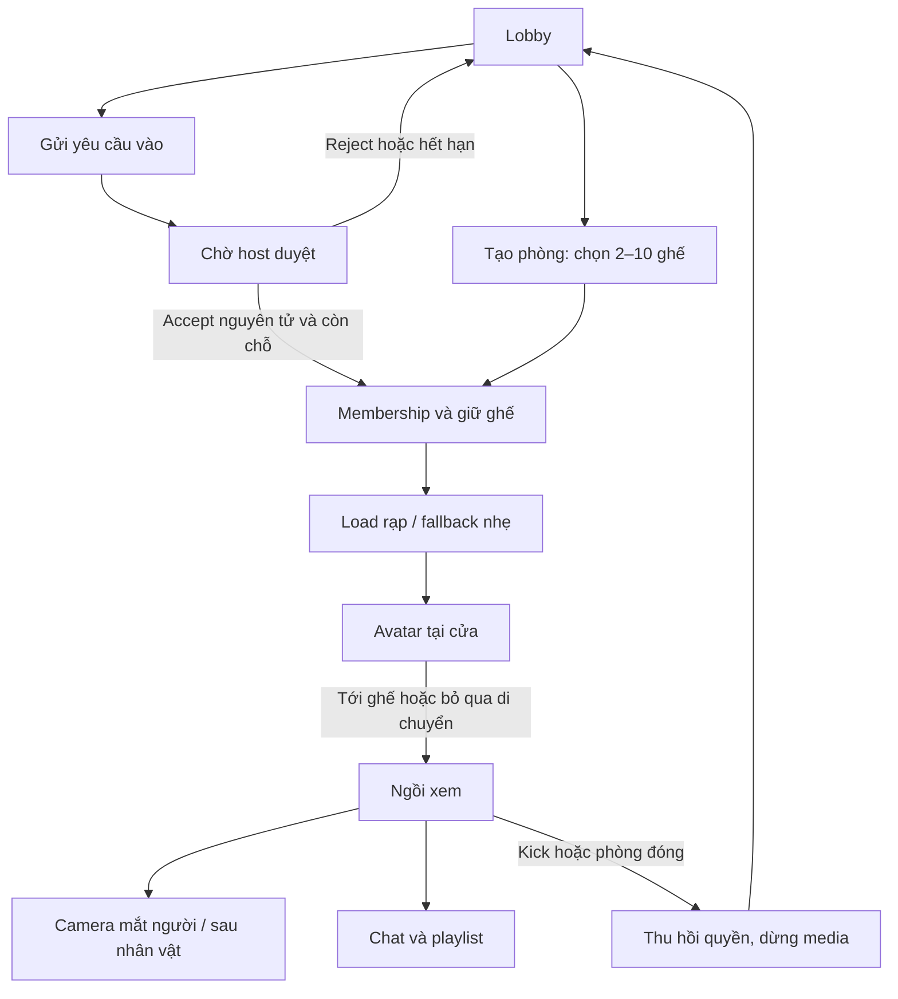
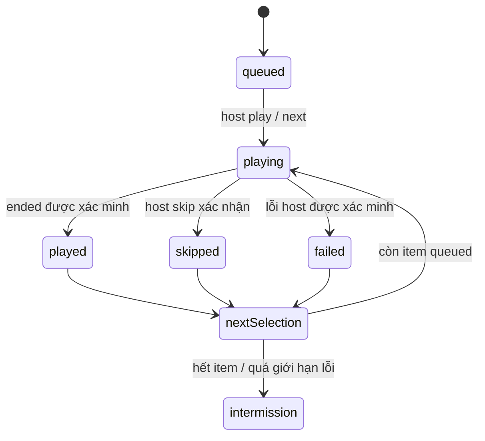

> Đặc tả sản phẩm gốc ngày 02/11/2026; các câu về trạng thái triển khai bên dưới là lịch sử tại ngày đó. Source, test và deploy hiện tại: [PROJECT_STATE](../PROJECT_STATE.md).

# Rạp 3D v3 — đặc tả sản phẩm và luồng tương tác

Ngày02/11/2026. **Đây là đặc tả hiện hành**, thay thế lựa chọn UI2D làm giao diện chính, giới hạn50người/phòng và việc để playlist ngoài MVP ở các bản trước. Chưa có scene3D hoặc backend được triển khai. Preview2D cũ chỉ là tham khảo bố cục chat.

## 1. Phạm vi và quy tắc

- Tối đa3phòng hoạt động; mỗi host chọn capacity là số nguyên2–10, tính cả host. Tối đa30người được nhận vào toàn hệ thống. Có đúng capacity ghế thực trong scene.
- “Tối thiểu2” được hiểu là sức chứa nhỏ nhất có thể chọn. Host được phát ngay khi ở một mình. Không có điều kiện đủ2người, không chờ người mới tải scene hoặc ngồi xuống. Người được duyệt vào sau nhận timeline hiện tại và xem tiếp. Số2 chỉ là sức chứa nhỏ nhất được chọn.
- Capacity khóa khi tạo phòng trong MVP; đổi bằng cách đóng/tạo lại để tránh ghế biến mất và đẩy người ngoài ý muốn. Chưa có đổi capacity khi đang chiếu.
- Có avatar3D, góc nhìn thứ nhất/thứ ba, nút đi tới ghế, playlist, yêu cầu vào/duyệt, kick/ban. Không voice call, không WebXR headset trong MVP; “như mắt người” là camera perspective trên màn hình.
- 3D diễn ra trên thiết bị người xem; giảm từ150 xuống30 không tự giải quyết GPU mobile hoặc inference miễn phí. Core cloud vẫn Worker +3DO, TTS provider có gate riêng.

## 2. Stack và ranh giới YouTube

Frontend React/TypeScript/Vite + Three.js/React Three Fiber; Drei dùng chọn lọc cho loader/camera, AnimationMixer cho avatar. GLB/glTF dùng mesh/material dùng chung; texture nén khi device hỗ trợ. Không thêm physics engine cho MVP: đường đi cố định và seat reservations đủ cho rạp nhỏ. UI chat/playlist/quyền bằng DOM accessible, tách khỏi canvas.

**YouTube player phải là iframe được hỗ trợ.** Không lấy pixel/video stream từ iframe cross-origin làm VideoTexture, không tách audio để xử lý surround. Không vẽ avatar/menu/canvas che controls, logo hoặc ads. Vì vậy màn chiếu3D là một integration spike bắt buộc:

1. Thử iframe DOM/CSS3D đặt theo mặt phẳng màn chiếu, cùng camera projection; kiểm tra pointer, fullscreen, zoom và minimum viewport200×200, không bị avatar/geometry che. DOM/CSS3D và WebGL không có depth occlusion chung tự động.
2. Chỉ dùng trong góc nhìn có vùng player nhìn thấy đủ lớn và tương tác được. Khi đi hành lang/nhìn lệch, chuyển tới **vùng player DOM riêng rõ ràng** ngoài canvas, không giả lập bằng stream bị trích xuất. Người dùng không bị mất điều khiển/phụ đề.
3. Nếu cách1 không đạt browser/policy/UX gate, giao diện vẫn là rạp3D nhưng khi ngồi xem dùng playerDOM lớn trong vùng xem riêng, khung cảnh rạp nằm xung quanh. Không hứa video là texture trong scene.
4. Giữ cùng iframe instance qua các góc nhìn nếu khả thi; không reparent/remount gây reload. Spike kiểm tra trước khi khóa cấu trúc DOM. Controls dành cho cả phòng nằm ngoài player.

Nguồn: [YouTube IFrame API](https://developers.google.com/youtube/iframe_api_reference), [yêu cầu tích hợp](https://developers.google.com/youtube/terms/required-minimum-functionality), [Three.js](https://threejs.org/docs/), [R3F performance](https://r3f.docs.pmnd.rs/advanced/scaling-performance). Các liên kết mô tả khả năng nền tảng, không phải bằng chứng integration3D đã chạy.

## 3. Rạp, ghế và đồ họa

Bố cục: cửa vào sau rạp → lối đi giữa → các nhánh tới ghế → màn chiếu trước rạp. Nền tối, ghế đỏ trầm, đèn bậc thang hổ phách, vật liệu vải/gỗ đơn giản. Không dùng poster phim thương mại để trang trí mặc định.

Seat layout xác định từ capacity, cùng seed/version trên mọi client:2–4ghế một hàng;5–8ghế hai hàng cân đối;9–10ghế hai hàng5 hoặc5+4. Ghế lẻ được căn giữa trong hàng, vẫn có aisle rõ và khoảng trống cho camera. Seat ID ổn định `A1..`, topology kèm path waypoints do server/config tin cậy cấp. Ghế giữ `free/reserved/occupied/reconnect-held`; avatar không ngồi ghế free.

Host được cấp một ghế khi tạo; guest được cấp ghế tại transaction accept, được đổi sang ghế free qua request. Chọn ghế là modal sơ đồ2D accessible hoặc click/raycast ghế3D; cả hai gửi cùng command. Không tự thay seat chỉ dựa animation client.

Asset plan: một scene modular, một mesh ghế instanced,2avatar low-poly mẫu có cùng skeleton,6palette áo/tóc, animations `idle/walk/turn/sit_down/seated_idle/stand_up`. Tên hiển thị nhỏ khi hover/chọn, không nổi che màn phim. Không upload avatar/model tùy ý trong MVP.

Nguồn asset ứng viên: [Kenney assets](https://kenney.nl/assets), [Quaternius](https://quaternius.com/), [Poly Haven license](https://polyhaven.com/license), [Mixamo FAQ](https://helpx.adobe.com/creative-cloud/faq/mixamo-faq.html). Chưa tải/chọn pack cụ thể hoặc xác minh license từng file; Kenney animated-characters link không đọc được ở lượt này. Phải kiểm tra quyền phân phối GLB/animation trên web, attribution và skeleton compatibility trước nhập. Ưu tiên scene tự dựng bằng primitives + avatar procedural placeholder để spike không chờ asset.

Asset manifest bắt buộc URL/license/author/revision/hash/modification. Không lấy asset bất kỳ rồi gắn nhãnCC0. Target ban đầu scene+avatar dùng chung≤5MB compressed, texture≤1024px mỗi atlas; avatar≤15k triangles mỗi người ở tier cao, LOD thấp khoảng3–5k; đo thật trên mobile trước tăng.

## 4. Hai camera và thao tác

| Thuộc tính | Góc1 — Mắt người | Góc2 — Sau nhân vật |
|---|---|---|
| Vị trí | Eye anchor ở đầu; lúc ngồi hạ theo seat pose | Sau lưng khoảng1,8m, cao hơn vai0,5m; raycast chống xuyên tường |
| FOV đề xuất |60°, tùy chọn55–75° |60°, framing giữ avatar và đường đi |
| Nhìn quanh | Drag khi pointer trên canvas; yaw giới hạn khi ngồi, pitch±35° | Drag orbit có giới hạn quanh avatar, không bay tự do |
| Khi ngồi | Hướng mặc định vào tâm màn chiếu | Avatar phía dưới khung hình, không che vùng playerDOM |
| Chuyển góc | Nút “Mắt người”/“Sau nhân vật”; shortcut C khi không nhập text | Blend250–400ms, reduced-motion đổi ngay |
| Hỗ trợ | “Nhìn về màn hình”, “Tới ghế”, “Bỏ qua di chuyển” | Các nút tương tự; mobile không yêu cầu pointer lock |

Không head-bob, motion blur, rung máy hay FOV tăng tốc mặc định. Camera cục bộ không broadcast. Pointer lock nếu bổ sung sau phải opt-in, Esc thoát; không chiếm chuột bàn phím ở iframe/chat. Không tự chuyển góc làm mất orientation khi video đổi. Góc mặc định vào rạp là thứ ba; sau ngồi giữ góc đã chọn, gợi ý góc thứ nhất một lần.

## 5. Chuyển động avatar và đồng bộ

State machine: `admitted → atEntrance → movingToSeat → turning → sittingDown → seated → standingUp → movingToSeat/atEntrance → leaving`. Reject/kick là terminal membership transition ưu tiên hơn animation.

1. Accept thành công: scene load, avatar xuất hiện tại cửa, ghế đã reserve; nhận snapshot trước render người khác.
2. Bấm “Tới ghế”: server xác nhận seat/path/startTime, client đi theo waypoint với tốc độ khoảng1,2m/s. Tổng đường đi mục tiêu4–8s, không vượt10s; disable lệnh trùng bằng commandId.
3. Tới seat anchor: turn0,2–0,4s → sit_down0,6–0,9s → seated_idle. Animation duration là cấu hình mỹ thuật, không quyết định membership.
4. “Bỏ qua di chuyển”: hoàn thành pose tại ghế bằng transition server chấp nhận, camera fade ngắn hoặc đổi ngay khi reduced-motion. Không bắt người dùng chờ animation để nghe phim.
5. Đổi ghế: reserve ghế mới nguyên tử, giữ ghế cũ trong transition có deadline; release cũ khi commit hoặc rollback mới nếu fail. Không để một người giữ hai ghế vô thời hạn. MVP có thể chỉ cho đổi trước chiếu để giảm race.
6. Ngồi xem: không loop idle liên tục trên mọi avatar. Thỉnh thoảng cử động nhỏ local tier cao; tắt ở low. Không gesture/reaction spam hoặc lip-sync phân tích audio trong MVP.
7. Reconnect: phục hồi seat và motion phase từ server time; nếu transition quá hạn snap vào seated. Không chạy lại cảnh bước vào từ đầu.

Server phát **transition có thời điểm**, không broadcast bone transforms/tọa độ60fps. Client nội suy path theo clock offset. Event gồm membershipId, seatId, motionRevision, pathId, startedAt, duration. Server chọn path và thời lượng; client không được tự gửi vị trí ngoài bounds. Snapshot có motion state hiện tại. Không cần player physics/network tick thường trực; giúp DO hibernate.

## 6. Ánh sáng và âm thanh

Ba lighting presets có server timestamp: `welcome` sáng nhẹ ở aisle; `screening` đèn trần dim trong2s, giữ đèn lối đi; `intermission` tăng sáng trong1,5s. Sử dụng baked AO/lightmap hoặc vật liệu có shading nhẹ;1key light, hạn chế shadow realtime. Không dynamic GI, không sample màu frame YouTube để chiếu sáng. Nút accessibility giữ sáng hơn chỉ trên thiết bị người dùng.

Âm thanh phim do YouTube phát nguyên bản và volume API; **không cam kết Dolby/5.1/7.1, âm lượng chuẩn rạp hoặc đo SPL trên loa/tai nghe không biết trước**. “Như rạp” ở đây là thiết kế không gian/thị giác; chất lượng phát phụ thuộc source và thiết bị.

TTS riêng có thể thử Web Audio panner theo ghế người nói khi audio được cấp CORS phù hợp; tùy chọn “Âm thanh không gian” off mặc định, luôn có stereo/mono rõ lời. Vị trí listener bám đầu avatar người dùng, không bám camera thứ ba để đổi góc không đổi cảm giác nghe. Reverb nhẹ tùy chọn chỉ với TTS/effect do app sở hữu, không áp lên audio YouTube. Âm bước chân off trong screening. Không phát bất ngờ trước gesture unlock.

TTS mặc định không làm giảm âm phim. Nếu thêm ducking opt-in, dùng volume API được hỗ trợ, không mute/điều chỉnh để né ads, kiểm tra chính sách trước bật. Hủy TTS/kick phải restore volume nếu từng thay; người dùng có quyền volume riêng mọi lúc.

## 7. Luồng các view

| View | Nội dung và hành động | Thành công → | Lỗi/ngoại lệ |
|---|---|---|---|
| Lobby |3slot; tên phòng public/capacity; tạo/xin vào |Create hoặcJoin |Không lộ tên/video phòng riêng;3slot bận |
| Create |Tên, capacity2–10, riêng/công khai, approval mặc định bật, avatar |RoomPrep |Slot tranh chấp trả về lobby; không tạo room4 |
| JoinRequest |Tên/avatar, gửi yêu cầu; biết chưa được vào |Waiting |Full/ban/expired/cooldown |
| Waiting |Đang chờ host, hủy; không video/chat/roster riêng |Loading nếu accept |Reject, timeout120s, host offline, phòng đóng |
| Loading |Tiến độ asset, tùy chọn chế độ nhẹ |Entrance |Asset fail → fallback2D vẫn dùng cùng seat/membership |
| Entrance |Góc thứ ba, sơ đồ seat, “Tới ghế” |Seated |Room closed/kick hủy load, dừng media |
| Seated |Camera toggle, playlist/chat/members drawer, sync, TTS |Watching |Autoplay block, video error, reconnect |
| Host dashboard |Requests, playlist, kick, quyền, đèn, bắt đầu |Room |Chưa có video, command stale, quyền mất |
| VoiceProfile |Luồng thu mẫu riêng từ menu |Quay room đúng state |Provider unavailable không thu mẫu vô ích |
| Exit |Thông báo rời/kick/closed, về lobby |Lobby |Không tự xin vào lại khi bị kick |

Panel DOM không phủ lên player YouTube; mobile mở drawer ngoài vùng player hoặc thay bố cục. Chế độ nhẹ vẫn hỗ trợ đầy đủ seat list/chat/playlist/approval; không ép mọi người có GPU mạnh mới được xem.

## 8. Playlist, Next và Skip

MVP playlist là **hàng đợi video của phòng**, không mặc định import toàn bộ link YouTube playlist. Import playlist thực cần YouTube Data API, key/quota/pagination riêng; ưu tiên sau khi core queue ổn. Nếu URL có cảvideoId+listId, giải thích chỉ thêm video hiện tại. URL chỉ list không có video → báo chưa hỗ trợ import, không scrape.

Data: queueItemId(random), videoId, title nếu metadata hợp lệ, addedBy, status `queued/playing/played/skipped/failed`, order, createdAt. Room giữ currentItemId, queueRevision, playbackGeneration, repeat=off. Cho trùng video với itemId khác; không dùng videoId làm idempotency key. Tối đa50items kể cả lịch sử trong phiên, chặn vượt trước ghiDB; policy dọn lịch sử phải giữ current/pending.

**Thêm:** host/mod dán URL hoặc nhiều URL (max10/lần) → validate từng URL/server videoID → xem danh sách hợp lệ/lỗi → xác nhận append → ACK queueRevision → mọi client thấy delta. Metadata loading không chặn thêm bằng videoID. Video còn có thể cấm embed khi phát, không hứa validate trước chắc chắn.

**Viewer:** bấm “Đề xuất video” → pending suggestion, chưa vào queue; host accept/reject. Giới hạn3suggestions/user pending, cooldown; accepted chuyển thành queue item một lần. Không tự chuyển video đang phát.

**Sắp xếp/xóa:** host/mod drag hoặc nút lên/xuống có keyboard; command chứa expectedQueueRevision. Chỉ reorder queued, không silently xóa current. Xóa current phải đi qua Skip rõ ràng. Stale trả snapshot; không tự retry reorder theo index cũ.

**Play:** khi có item, host có thể bắt đầu ngay dù đang một mình → server chọn item, tăng generation, commit anchor → broadcast → clients load cùng video và target. Chế độ preload chỉ metadata, không tạo iframe autoplay thứ hai.

**Next:** khi current kết thúc hoặc host bấm “Phát tiếp”, server chọn queued item đầu tiên. Nếu current chưa hết thì hiển thị “Chuyển sang video tiếp theo?” và sau xác nhận đánh dấu current skipped. “Phát ngay” một item cụ thể cũng dùng cùng transition.

**Skip:** host/mod bấm “Bỏ qua video này” → xác nhận khi đang phát → server đánh dấu skipped(reason=host), chọn next. Viewer chỉ đề nghị skip; vote-skip chưa tự động bật ở MVP. Không đủ next → ended/empty, ánh sáng intermission, không loop video cũ. UI cho Undo reorder trước phát; không Undo tự tua lại cả phòng sau Next.

**Auto-next:** ended của client là gợi ý, không nguồn chân lý tuyệt đối. Chỉ host/controller được gửi kết thúc kèm itemId/generation và position; server kiểm tra duration/anchor nếu biết. Không tin event viewer đơn lẻ. Host mất kết nối/không có controller → giữ cuối video, không để ai cũng next. Ads/buffering có thể khác máy; không dùng wall-clock duration duy nhất để nhảy khi host chưa ended. Đồng bộ hết hạn không thể bảo đảm frame-perfect qua quảng cáo.

**Race:** ended + Next + duplicate retry trên cùng generation chỉ chuyển một lần bằng transaction và transitionId. Request kỳ vọng generation cũ reject, không skip tiếp item mới. Tất cả thiết bị dùng generation guard hủy callback/audio của item cũ.

**Video lỗi:** một viewer lỗi vùng/ads không làm skip cả phòng. Host error100/101/150 → UI nêu lý do, cho Skip; có thể bật auto-skip lỗi đã xác nhận ở host, tối đa3item liên tiếp rồi dừng. Reconnect nhận current snapshot + queueRevision, không replay queue command offline.

## 9. Accept / reject vào phòng

Default approval bật ở cả phòng riêng/công khai. Invite link không tự bỏ qua approval và không cấp host role. Waiting request không nhận chat/video/avatar positions; không giữ một ghế khi mới xin.

State: `pending → accepted/reserved → joined`; hoặc `rejected/cancelled/expired`. Pending TTL120s, tối đa20/room,1request/session/room, retry cooldown30s. Pending count không tính occupancy nhưng tiêu quota riêng.

Host drawer hiển thị tên/avatar/thời điểm, Accept/Reject; không lộ email/IP. Accept transaction kiểm tra request pending, roomSessionId, capacity, host permission, session ban; cấp membership+seat và reservation20s. ACK tới host/requester. Hai Accept tranh ghế cuối chỉ một thành công. Requester kết nối socket nhận membership rồi chuyển joined; asset3D load chậm không làm mất ghế khi socket đãjoined.

Accepted không connect trong20s → reservation expire và release seat; host thấy “Chưa kết nối”. Full thì Accept disabled theo snapshot, server vẫn kiểm tra race. Reject chỉ gửi lý do chung, có cooldown; không public người bị từ chối. Khi host offline giữ pending tới TTL, không auto-accept. Approval handler idempotent.

Tắt/bật approval sau tạo là host setting có revision: bật không kick người đã vào; tắt không auto-accept hàng chờ cũ, host phải xử lý rõ. Có thể giữ approval always-on ở alpha để giảm nhánh test.

## 10. Kick, ban và rời phòng

Host chọn thành viên → menu “Mời ra khỏi phòng” → xác nhận tên + tùy chọn “Chặn quay lại phiên chiếu này”. Mặc định kick với cooldown60s; ban chặn đến roomSessionId kết thúc. Không cho kick chính host bằng menu này; host muốn rời dùng chuyển quyền/đóng. Moderator không kick host hoặc moderator ngang quyền nếu policy không cho.

Server transaction: check role/epoch → revoke membership và sessions scoped room → cancel pending TTS của user, bỏ clip chưa phát nếu policy room → release seat/reservation → đóng WS có code/reason → broadcast memberRemoved. Current TTS đang phát dừng trên client qua cancellation event best-effort. Request đang chạy provider có thể không hủy được; output về bị discard, không phát và không hoàn phí quota giả.

Client bị kick: dừng player/TTS, release mic nếu đang enrollment, dispose scene/mixer, về view thông báo; không cho animation rời cửa trì hoãn revoke. Các client còn lại fade avatar150–250ms hoặc xóa ngay reduced-motion; không có hiệu ứng bêu xấu.

Kick không tự xóa toàn bộ chat cũ; host có action xóa tin riêng. Profile giọng cá nhân là dữ liệu tài khoản, không bị host xóa toàn cục. Không cấp URL audio mới cho membership revoked; signed URL đã cấp TTL≤60s và file đã tải không thu hồi.

Guest xóa cookie có thể trở lại như người mới; approval/private invite rotation hỗ trợ nhưng không hứa ban danh tính tuyệt đối. Ban theo account khi có account, không chỉ nickname hoặc IP. Host kick và reconnect chạy đồng thời phải kiểm tra revocation trước lease restore.

## 11. Protocol và dữ liệu bổ sung

Commands: `join:request/cancel`, `join:decide`, `seat:change`, `avatar:moveToSeat/skipMotion`, `queue:add/reorder/remove/playNext/playNow/suggest/decideSuggestion`, `member:kick`, `room:setLights/startSession`.

Server events: `join:status`, `membership:admitted/revoked`, `seats:snapshot/delta`, `avatar:transition`, `queue:snapshot/delta`, `playback:state`, `room:lighting`. Mọi mutation có commandId, expectedRevision liên quan, roomSessionId; role và limits tại server. Không gửi raw coordinate/modelURL/avatar binary tùy ý.

Tables bổ sung: room_settings(capacity,approval,layoutVersion), seat, join_request, queue_item, queue_suggestion, membership_ban, motion_state. Room actor transaction bảo đảm occupied+reserved+reconnectHeld≤capacity. Không dùng lobby cache để quyết định accept.

## 12. Performance và chất lượng

Target chưa đo: desktop60FPS/tier medium, mobile30FPS/tier low trong rạp10avatar; p95 frame≤33,3ms ở mobile mục tiêu. Benchmark khi video đangdecode+chat+TTS, không chỉ scene trống. DPR≤1,5desktop/1mobile ban đầu; shadow off mobile, baked light; instancing ghế, texture atlas, GLB cache, không React setState mỗi frame.

Khi camera/avatar chuyển động: animate liên tục cần thiết. Khi mọi người ngồi, dừng idle và dùng demand rendering; videoDOM vẫn phát độc lập. Chuyển tab/background giảm loop, foreground resync. Dispose GPU/audio resources khi rời; WebGL context lost → fallbackDOM không mất membership.

Free budget tính lại:30user×7200s/30s=7200incoming messages/ngày theo mô hình cũ, chưa tính approval/queue/avatar events.10người nghe clipPCM5s≈2,205MB, budget2GB≈907clip/tháng trướcoverhead. Opus32kbps5s×10≈0,2MB,2GB≈10000clip/tháng nếu codec thật có. Đây là upper-bound minh họa, **quota inference vẫn độc lập**; không suy ra TTS miễn phí đủ dùng. DO vẫn3objects, active duration không tự giảm5lần.

## 13. Kiểm thử nghiệm thu v3

- capacity2/3/5/9/10: đúng sốmesh ghế, ID/path valid; không hidden ghế giả. Người capacity+1 bị từ chối.
-50request chờ tranh10ghế,20Accept đồng thời, accept/reject/cancel/timeout race: không vượtcap, không double seat. Max20pending.
- Cả3phòng×10người, reconnect/host transfer/kick khi loading/moving/seated; avatar state nhất quán, không người vô hình còn quyền.
- Chuyển2camera khi đi/ngồi, quay sát tường, resize/zoom, reduced-motion/skip animation, touch/keyboard, chat typing không kích hoạt camera shortcut.
- PlayerDOM/CSS3D: fullscreen, captions, controls, browser zoom, iOS/Android, autoplay, ads; không che player hoặc extract stream.
- Playlist: duplicates, batch sai một phần, current delete, reorder stale, empty next, ended+skip race, lỗi3video, host offline, requester bịkick.
- Security: guest tự accept, sửa capacity/seat/path/role, gửi motion spam, kick người khác, URL injection đều reject.
- Mobile 30phút và3×10socket2giờ: FPS/thermal/memory/DOwrites/egress; độ trễ sync/chat không bị scene ảnh hưởng.
- Audio: unlock, mute, TTS spatial toggle, camera không đổi listener, không phát bước chân khi chiếu; không gắn nhãn Dolby chưa có.

## 14. Timeline v3 ban đầu — được cập nhật tại kế hoạch đồ họa

Phạm vi3D +approval +playlist là tăng đáng kể so với2D. Ước lượng mới, chưa phải lịch cam kết: spike player/camera/assets3–5ngày; scene/avatar/camera6–9; admission/seat/moderation4–6; playlist4–6; tích hợpUI/accessibility3–4; perf/browser/security4–6. Tổng nhánhv3 **24–36ngày công**, có phần thay cho UI/core/QA cũ, không cộng thẳng vào33–47.

Lập baseline triển khai lại: feasibility4–6; cloud/core sync/chat8–12; scene/camera/avatar6–9; approval/seats/playlist6–9; TTS7–10nếugateđạt; QA/security/release6–9 → **37–55ngày công** cho full scope, chưa kể chờ provider/quyền. Alpha3D không cloning có thể theo nhánh30–45ngày công; giữ release gates riêng. Sau spike5ngày đầu phải re-estimate từ dữ liệu thật, đặc biệt màn chiếu iframe3D.

## 15. NVIDIA NIM và credential

Không lưu key đã gửi trong hội thoại vào repo/tài liệu/log. Khuyến nghị rotate và cấu hình key mới vào secret `NVIDIA_API_KEY`; quyền Zeroshot phải kiểm tra riêng. Chưa có authenticated inference được thực hiện. Endpoint trial vẫn chỉ đánh giá theo terms đã nghiên cứu; giảm số người không thay đổi hạn chế production.

## 16. Sơ đồ luồng chính

## Cập nhật: phát liên tục, không đợi người vào

Video không đợi duyệt người mới, tải3D, đi tới ghế hoặc autoplay unlock. Late join phải lấy timeline mới nhất ngay trước khi play/seek, không dùng timestamp lúc vừa được accept. [Kế hoạch đồ họa và công nghệ chi tiết](DO_HOA_VA_CONG_NGHE_RAP_3D.md) là bản triển khai bổ sung hiện hành.

## Nguồn file đã khảo sát

[Xem danh mục gói model, animation, texture và UI cụ thể](NGUON_FILE_DO_HOA.md). Có phân biệt bản miễn phí/trả phí và nguồn chưa xác minh tải; chưa nhập binary vào dự án.
