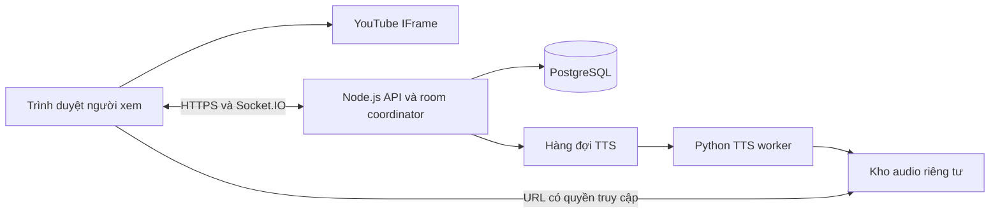

# Kế hoạch phát triển rạp xem chung YouTube

Ngày nghiên cứu: 01/11/2026. Trạng thái: đề xuất kỹ thuật, chưa triển khai hay đo tải thực tế.

## 1. Phạm vi và giả định

Xây ứng dụng web responsive: người tổ chức tạo phòng, nhập một link YouTube, chia sẻ link mời; người tham gia xem tại cùng vị trí phát, chat và dùng tính năng giọng nói.

- Tối đa 3 phòng hoạt động toàn hệ thống; mỗi phòng 50 người, bao gồm host/moderator. Tổng 150 người đồng thời.
- Đây là giả định về hạn mức, không phải 3 phòng cho mỗi tài khoản. Room slot được giải phóng khi đóng phòng.
- Một phòng có một video hiện tại; 3 phòng được phép dùng 3 link khác nhau.
- Ưu tiên trình duyệt desktop và mobile; chưa làm native app.
- MVP hỗ trợ video YouTube thông thường được phép nhúng. Livestream/DVR cần cơ chế timeline riêng, để giai đoạn sau.
- Chủ phòng đăng nhập; khách vào bằng tên hiển thị và phiên guest do server cấp. Không cần tài khoản YouTube trong app.
- Đã xác nhận: voice là text-to-speech. Người dùng đăng ký mẫu giọng của chính mình để đọc chat bằng giọng cá nhân; không đăng ký thì chọn giọng nam/nữ mặc định. Không cần voice chat bằng mic hay LiveKit/SFU.
- Chưa có mã nguồn dự án, README hay AGENTS.md trong workspace tại thời điểm khảo sát. Nghiên cứu source bên ngoài chỉ là tham khảo, chưa audit toàn repo.

## 2. Kết quả nghiên cứu và quyết định

### YouTube

IFrame API có play/pause/seek, đọc currentTime và sự kiện autoplay bị chặn. Một số video không cho nhúng; cần xử lý lỗi 100, 101/150, 153 và trạng thái player chưa sẵn sàng. [Tài liệu API](https://developers.google.com/youtube/iframe_api_reference).

Mỗi người tải video trực tiếp từ YouTube. Backend chỉ gửi metadata, trạng thái và chat. Không lấy MP4/MP3 từ YouTube hay phát lại video qua server của ứng dụng.

Không hứa đồng bộ tuyệt đối: quảng cáo, buffering, giới hạn khu vực và autoplay có thể khác nhau giữa người xem. IFrame API không cung cấp cơ chế tổng quát đáng tin để đồng bộ mọi quảng cáo; chỉ hiệu chỉnh khi nội dung có thể phát và cung cấp nút “Đồng bộ lại”.

Chế độ nghe nhạc vẫn giữ player hiển thị. Không thiết kế tách audio, giấu player phát nền hay chặn quảng cáo. [Chính sách YouTube](https://developers.google.com/youtube/terms/developer-policies). Nếu triển khai bán vé/chiếu thương mại, cần đánh giá riêng quyền nội dung trước khi mở tính năng đó.

### Source tham khảo

Đã đọc README, package.json và các đoạn room state, admission, play/pause/seek, chat trong [howardchung/watchparty](https://github.com/howardchung/watchparty), đặc biệt [server/room.ts](https://github.com/howardchung/watchparty/blob/master/server/room.ts). Repo công bố MIT; sử dụng React/TypeScript, Node và Socket.IO. Source có state phòng, kiểm tra sức chứa, nhận diện reconnect, lệnh điều khiển và broadcast.

Khuyến nghị xây codebase gọn theo phạm vi này. Repo tham khảo có nhiều phần ngoài nhu cầu như virtual browser và nhiều nguồn media. Chưa có bằng chứng từ lần đọc này rằng fork nguyên repo đáp ứng an toàn 3×50 người. Nếu tái sử dụng code, pin commit, giữ thông báo MIT và audit dependency/permission trước.

### Realtime và âm thanh

Socket.IO đảm bảo thứ tự sự kiện nhận được nhưng mặc định không bảo đảm mọi sự kiện đều đến nơi. Vì vậy cần ACK, command ID, chống lặp và snapshot khi reconnect. [Delivery guarantees](https://socket.io/docs/v4/delivery-guarantees/).

### TTS và nhân bản giọng: lựa chọn đã nghiên cứu

| Giải pháp | Kết quả đối chiếu tài liệu | Đề xuất |
|---|---|---|
| [VieNeu-TTS](https://github.com/pnnbao97/VieNeu-TTS) | Repo công bố v3 Turbo mã nguồn mở, giọng preset và cloning tiếng Việt từ clip ngắn; v4 là proprietary | Thử v3 Turbo trước; pin model/code, kiểm tra license từng artifact |
| [VoxCPM2](https://github.com/OpenBMB/VoxCPM) | Tài liệu liệt kê tiếng Việt, voice cloning, code và weights Apache-2.0 | Đối chứng chất lượng; đo CPU/GPU và latency trước khi chọn |
| [ElevenLabs](https://elevenlabs.io/docs/help-center/product/voices/my-voices/what-is-my-voices) | Instant Voice Cloning ở Starter trở lên | Phương án trả phí, không coi là cloning miễn phí |
| [XTTS-v2 gốc](https://huggingface.co/coqui/XTTS-v2) | Danh sách ngôn ngữ không có tiếng Việt; Coqui Public Model License | Không chọn làm mặc định cho dự án tiếng Việt |
| [Web Speech API](https://developer.mozilla.org/en-US/docs/Web/API/SpeechSynthesis/getVoices) | Giọng phụ thuộc thiết bị, không tạo bản sao giọng cá nhân | Chỉ fallback cục bộ, không bảo đảm cặp giọng Việt nam/nữ |

Đã đọc README upstream VieNeu và VoxCPM; chưa chạy model, chưa kiểm chứng số liệu benchmark hoặc chất lượng giọng. Miễn phí mã nguồn/weights không đồng nghĩa có API miễn phí vận hành 150 người. Không dựa vào demo công cộng làm backend production. Đề xuất tự host TTS; dùng cùng engine với hai preset nam/nữ đã kiểm tra để mọi người nghe nhất quán.

### Skills đã đọc

- `cloud-environment-runtime`: kiểm tra workspace và network trước khi nghiên cứu.
- `vercel:create-a-backend`: phân loại HTTP, realtime, dữ liệu và dịch vụ độc lập trước khi chọn công nghệ. Không hàm ý phải dùng Vercel.
- Khi code React nhiều component: áp dụng `vercel:react-best-practices`; khi kiểm tra luồng hoàn chỉnh có thể dùng `vercel:verification`. Đây là các skill dự kiến, chưa áp dụng trong lượt nghiên cứu.
- Không cần AI agent/LLM cho đồng bộ video, chat hoặc voice chat. TTS không đồng nghĩa cần xây AI agent.

## 3. Kiến trúc đề xuất



| Thành phần | Chọn cho MVP | Lý do |
|---|---|---|
| Frontend | React + TypeScript + Vite | Ứng dụng tương tác, chưa cần SSR |
| UI | Tailwind hoặc thư viện component thống nhất | Responsive, accessible, phát triển nhanh |
| Backend | Node.js LTS + Express + Socket.IO | HTTP và kết nối realtime trong một dịch vụ |
| Validation | Schema dùng chung, ví dụ Zod | Kiểm tra payload ở server và client |
| Database | PostgreSQL + migration | Room slot, phiên, tin nhắn, state, audit |
| Realtime state | Một coordinator process, hàng đợi tuần tự mỗi phòng | Đủ đơn giản cho 150 người; đo tải để xác nhận |
| TTS | Python worker + VieNeu-TTS, thử VoxCPM2 đối chứng | Giọng Việt cá nhân và preset nam/nữ |
| Hàng đợi/audio | PostgreSQL job queue + object storage riêng tư | Sinh một lần, phát cho cả phòng, retry có giới hạn |
| Hosting | Static CDN + một container/VPS cho API | Dễ vận hành và kiểm soát WebSocket |
| Kiểm thử | Vitest, Playwright, socket.io-client load harness, TTS benchmark harness | Đo riêng logic, UI và media |

Không cần Kubernetes hoặc microservices cho quy mô đầu. Redis chưa bắt buộc khi chỉ có một room coordinator. Nếu cần nhiều replica, phải có phân quyền room owner/lease và fencing hoặc shared atomic state; chỉ thêm Redis Pub/Sub adapter không giải quyết tranh chấp state và hạn mức.

MVP một coordinator là điểm lỗi đơn. Chấp nhận reconnect ngắn khi restart, có phục hồi DB; chưa cam kết HA. Nếu yêu cầu không gián đoạn phải thêm giai đoạn HA riêng.

## 4. Luồng sản phẩm và quyền

1. Lobby hiển thị tối đa 3 phòng, tiêu đề, video đang chiếu, số người và trạng thái khóa/đầy.
2. Host đăng nhập, tạo phòng, nhập YouTube URL và nhận link mời.
3. Khách nhập tên, được server cấp session và admission; phòng đầy hiển thị thông báo rõ ràng.
4. Khách bấm “Vào xem” để khởi tạo media; xin quyền mic chỉ trong màn hình đăng ký giọng riêng.
5. Nhận snapshot, tải video, đợi player ready rồi seek đến vị trí phòng.
6. Host điều khiển play/pause/seek/đổi link; khách chỉnh âm lượng và chất lượng riêng.
7. Chat và điều khiển đọc tin nhắn hoạt động bên cạnh player. Điện thoại dùng tab Chat/Thành viên, không che player.
8. Host đóng phòng: thu hồi phiên phòng, hủy hàng đợi đọc chat, giải phóng slot, cập nhật lobby.

| Quyền | Admin | Host | Moderator | Viewer |
|---|---|---|---|---|
| Tạo phòng trong hạn mức | Có | Có | Không | Không |
| Play/pause/seek/đổi video | Có | Có | Có khi được cấp | Không |
| Chat và gửi đọc TTS | Có | Có | Có | Có |
| Xóa tin/kick/chặn gửi TTS | Có | Có | Có | Không |
| Đóng phòng/chuyển host | Có | Có | Không mặc định | Không |

Player YouTube có thể cho viewer thao tác tại máy; các thao tác này không được phát thành lệnh chung. Hiển thị trạng thái phát cục bộ khác phòng và nút theo lại phòng. Không phủ lớp vô hình để chặn chức năng player.

Host mất mạng: giữ quyền 30 giây cho reconnect; sau đó chuyển cho moderator đủ quyền theo quy tắc xác định. Nếu không có moderator, tiếp tục timeline nhưng khóa điều khiển chung, admin có thể nhận quyền. Host cũ quay lại không tự giành lại quyền.

## 5. Cơ chế đồng bộ video

Server là nguồn trạng thái chung, không lấy timestamp của viewer bất kỳ làm chuẩn.

```ts
type PlaybackState = {
  roomId: string;
  roomEpoch: string;        // thay khi tái tạo room/session
  videoId: string | null;
  mediaGeneration: number; // tăng khi đổi video
  status: 'idle' | 'playing' | 'paused' | 'ended';
  positionSec: number;
  anchorServerTimeMs: number;
  playbackRate: 1;          // MVP cố định 1x
  revision: number;
  hostMemberId: string;
};
```

Vị trí kỳ vọng khi playing:

`targetSec = positionSec + (estimatedServerNowMs - anchorServerTimeMs) / 1000`

Khi paused/ended, target là positionSec. Clamp về giới hạn video khi biết duration. Đồng hồ runtime dùng monotonic clock; thời gian lưu DB được ánh xạ rõ ràng, tránh clock jump làm seek bất thường.

- Lệnh gồm commandId, roomEpoch, expectedRevision, mediaGeneration và payload. Server xác thực thành viên/quyền, kiểm tra số hữu hạn và tuần tự hóa xử lý.
- Lệnh hợp lệ được ghi transaction, tăng revision, ACK và broadcast state. CommandId đã nhận được trả lại kết quả cũ, không thực thi hai lần.
- Client dùng revision để bỏ state cũ; thấy gap hoặc reconnect thì xin snapshot. Không replay lệnh điều khiển cũ đã hết hạn sau khi offline.
- Ping/pong nhiều mẫu để ước lượng offset; ưu tiên mẫu RTT thấp, loại outlier. Kiểm tra lại định kỳ và khi tab trở lại foreground.
- Snapshot/checkpoint đề xuất mỗi 5 giây, client kiểm tra drift mỗi 2 giây; điều chỉnh sau spike.
- Ngưỡng đề xuất: lệch dưới 0,5 giây thì bỏ qua; 0,5–1,5 giây thì quan sát thêm; lệch trên 1,5 giây bền vững thì seek lại. Có cooldown để tránh seek liên tục.
- Không dùng playbackRate tùy ý như 1,03x vì player chỉ hỗ trợ các rate khả dụng. MVP giữ 1x.
- Đổi video tăng generation và hủy callback player cũ; có guard khi áp dụng state để không sinh vòng lặp play/pause event.
- Buffering hoặc autoplay block tại một người không tự pause cả phòng. UI chỉ rõ trạng thái cục bộ và hướng dẫn tiếp tục.
- Khi server restart: load snapshot cuối, chuyển về paused tại anchor đã lưu, tăng revision, yêu cầu host tiếp tục. Đây là lựa chọn recovery minh bạch thay vì đoán thời gian đã phát khi server down.

SLO đề xuất, chưa được chứng minh: p95 lệch timeline ≤1 giây ở các player đang phát ổn định, foreground, không bị chặn/quảng cáo/buffering. Báo cáo cả tỷ lệ thời gian nằm ngoài điều kiện này để tránh chỉ số đẹp nhưng trải nghiệm kém.

## 6. Hạn mức 3 phòng và 50 người

- Tạo sẵn 3 room slot trong DB; tạo phòng phải lock và claim một slot trống trong transaction. Ràng buộc unique bảo vệ không cấp một slot hai lần.
- Join phải khóa room row, kiểm tra lease thành viên còn hạn và cấp membership nguyên tử. Không dùng kiểm tra count rồi insert ở hai bước rời nhau.
- Đếm người theo membership/session do server ký, không tin clientId tự khai. Guest là phiên trình duyệt, chưa thể xác minh một người thật duy nhất.
- Một membership chỉ có một kết nối điều khiển active; tab mới takeover kết nối cũ để tránh hai tab cộng/giành trạng thái khó đoán.
- Disconnected giữ slot tối đa 30 giây; reconnect dùng lại membership. Leave chủ động trả slot ngay. Người đã hết lease phải admission lại, có thể bị từ chối nếu phòng đầy.
- Khi đổi phòng: đóng membership và dừng audio TTS ở phòng cũ rồi xin phòng mới. Không giữ chỗ vô hạn.
- Race acceptance: 100 yêu cầu join cùng phòng chỉ có 50 membership được cấp; tạo 10 phòng đồng thời chỉ có 3 thành công.

## 7. Chat, voice và TTS

### Chat chữ

- Tin nhắn có messageId/clientMessageId, roomSessionId, senderMembershipId, nội dung text, createdAt và trạng thái moderation.
- Giới hạn đề xuất 500 ký tự; 5 tin/10 giây/người, có giới hạn thêm theo phòng/IP hợp lý.
- ACK sau khi lưu DB; retry idempotent; tải trang lịch sử theo cursor, ban đầu 100 tin.
- Render text an toàn; không HTML tùy ý. Tên hiển thị không thay thế danh tính server.
- Xóa tin phát tombstone để các client cập nhật. Đề xuất retention 7 ngày, có job xóa; cần xác nhận theo nhu cầu sản phẩm.

### Đăng ký giọng cá nhân

1. Người dùng đăng nhập để lưu giọng lâu dài; guest vẫn dùng preset nam/nữ.
2. Hiển thị câu mẫu ngẫu nhiên và nút thu giọng của chính mình; xác nhận đồng ý sử dụng giọng cho TTS của tài khoản.
3. Thu khoảng 15–30 giây trong phòng yên tĩnh. Backend chọn đoạn sạch theo yêu cầu model; với model cần transcript phải khớp nội dung thực thu. Không mặc định toàn bộ đoạn thu đều đã đọc đúng.
4. Kiểm tra duration, codec, clipping, silence và tiếng ồn; giới hạn upload, decode trong worker cách ly. Câu ngẫu nhiên giảm việc dùng clip có sẵn nhưng không phải xác minh danh tính tuyệt đối.
5. Sinh câu thử mới, người dùng nghe trước rồi lưu hoặc thu lại. Không hứa giống 100%; đo mức hài lòng và độ rõ tiếng Việt.
6. Lưu voice profile gắn owner, modelVersion, referenceVersion và consentAt. Chỉ chủ giọng được dùng profile để tổng hợp tin của mình.
7. Có thao tác xóa/thay giọng: thu hồi profile, hủy job chờ, xóa sample/embedding/audio cache liên quan; theo dõi hoàn tất và thời hạn xóa backup. Không thể thu hồi audio người nghe đã tải về.

Zero-shot cloning là hướng đầu tiên; không fine-tune model riêng cho từng người ở MVP. Reference sample là dữ liệu riêng tư, không phân phối cho người trong phòng. Mẫu gốc chỉ giữ nếu engine cần cho inference và người dùng đồng ý; profile có thể giữ embedding hoặc reference mã hóa tùy engine.

### Gửi chat và phát lời đọc

- Tin chữ hiển thị ngay sau ACK; TTS chạy bất đồng bộ và không chặn play/pause của phim.
- Người gửi chọn “Gửi” hoặc “Gửi và đọc”. Host có thể bật/tắt đọc chat của phòng. Mỗi người nghe có nút tắt TTS và chỉnh âm lượng riêng.
- Server chọn profile thuộc người gửi; nếu không có thì preset nam/nữ theo lựa chọn. Không nhận voiceId tùy ý để dùng giọng người khác.
- Một message chỉ tạo một audio, phân phối cho tối đa 50 người; không gọi model 50 lần.
- Cache key gồm text chuẩn hóa, voiceProfileId + version, modelVersion, tham số; cache và quyền truy cập phân vùng, không dùng text làm key duy nhất.
- Khi clone lỗi: thử lại tối đa một lần; có thể phát preset người dùng đã chọn và hiển thị nhãn “giọng mặc định”. Không giả vờ đó là giọng cá nhân. Nếu TTS vẫn lỗi thì giữ chat chữ.
- Giọng tổng hợp có nhãn rõ trên tin nhắn. Không dùng voice clone làm bằng chứng xác thực người gửi; danh tính vẫn do session server.

### Hàng đợi phát chung và chống ùn tắc

- Mỗi phòng chỉ phát một lời đọc tại một thời điểm, theo server sequence. Job chậm quá timeout sẽ bỏ lượt để không chặn toàn phòng.
- Giới hạn đề xuất: mỗi tin đọc tối đa 120 ký tự hoặc 10 giây audio; cooldown 10 giây/người; queue mỗi phòng tối đa 5 tin và 30 giây chờ. Tin không nhận vào TTS vẫn được gửi dưới dạng chữ.
- Nếu mọi tin dài 5 giây, phòng chỉ nghe được tối đa khoảng 12 tin/phút. 50 người chat nhanh không thể được đọc hết mà không tồn đọng; sản phẩm cần hiển thị rõ tin nào được xếp hàng.
- Worker tạo clip hoàn chỉnh trước cho MVP. Khi ready, server gửi audioId, sequence, startsAt và duration, chừa khoảng 1 giây preload; client dùng clock offset đã có để phát.
- Client tải chậm có thể seek tới offset hiện tại nếu còn hợp lý, hoặc bỏ lượt; không giữ toàn phòng chờ. Người join giữa chừng không replay backlog cũ.
- Mục tiêu p95 lệch thời điểm bắt đầu audio ≤500ms với client đã preload và được phép phát âm thanh; chưa cam kết trước benchmark.
- Lịch TTS là timeline riêng: pause phim không tự đọc lại chat, seek phim không seek TTS. Đổi/đóng phòng hủy queue; xóa tin sẽ hủy audio chưa phát và gửi stop nếu đang phát.
- Tự giảm âm lượng YouTube khi đọc chỉ khi người nghe bật lựa chọn này; phục hồi đúng mức trước đó và không tác động trạng thái video chung.
- Không thể chặn audio đã tải chỉ bằng URL hết hạn. Dùng TTL ngắn, kiểm tra membership khi cấp URL, và không ghi URL/token vào log.

## 8. Dữ liệu và API dự kiến

| Bảng | Vai trò |
|---|---|
| users / guest_sessions | Danh tính, phiên hết hạn |
| room_slots | 3 slot cố định và phòng đang chiếm slot |
| room_sessions | Host, tên, status, privacy, invite hash, thời điểm mở/đóng |
| memberships | Danh tính trong phòng, role, lease, trạng thái admission |
| playback_states | Snapshot và revision hiện hành |
| processed_commands | Idempotency có TTL, scope theo room epoch và actor |
| chat_messages | Tin nhắn, cursor, moderation và retention |
| moderation_actions | Kick/ban, chặn TTS, chuyển host, audit |
| voice_profiles | Owner, consent, reference/model version, preset, trạng thái xóa |
| tts_jobs / audio_assets | Message, idempotency, attempts, deadline, audio key, duration, TTL |
| room_audio_queue | Sequence, scheduledAt, trạng thái phát/hủy |

Index theo roomSessionId + createdAt/messageId cho chat; unique cho roomSessionId + member identity và commandId scope. Foreign key và transaction bảo vệ vòng đời room slot. Audio/reference lưu trong object storage riêng tư; DB lưu metadata và quyền, không lưu video YouTube.

HTTP dự kiến:

- `GET /rooms`: lobby.
- `POST /rooms`: tạo phòng trong hạn mức.
- `POST /rooms/:id/join`: admission và membership.
- `POST /rooms/:id/leave`: giải phóng membership.
- `POST /rooms/:id/close`: đóng phòng, giải phóng slot.
- `GET /rooms/:id/messages?cursor=...`: lịch sử chat có quyền truy cập.
- `POST /me/voice-profile`: đăng ký mẫu giọng có giới hạn upload.
- `POST /me/voice-profile/preview`: nghe thử giọng.
- `DELETE /me/voice-profile`: xóa giọng và hủy job liên quan.
- `POST /rooms/:id/messages/:messageId/speech`: yêu cầu đọc tin của chính mình.
- `GET /rooms/:id/audio/:audioId`: cấp quyền audio cho thành viên hợp lệ.

Socket client → server: `room:resume`, `playback:command`, `chat:send`, `tts:request`, `moderation:command`, `clock:ping`.

Socket server → client: `room:snapshot`, `room:members`, `playback:state`, `chat:message`, `chat:deleted`, `tts:ready`, `tts:scheduled`, `tts:cancelled`, `room:closed`, `command:ack`.

Mọi event kiểm tra auth, membership, role, room epoch, schema và rate limit ở server. Không cho client tự chọn bất kỳ room namespace nào để subscribe.

## 9. Cấu trúc source khi bắt đầu

```text
apps/web/src/
  features/lobby/
  features/room/
  features/player/
  features/chat/
  features/voice-profile/
  features/tts/
apps/api/src/
  auth/
  rooms/
  playback/
  chat/
  tts/
  moderation/
apps/tts-worker/         # model adapter, inference, preprocessing
packages/protocol/       # schema, event types, error codes
packages/sync-core/      # pure timeline/revision/idempotency logic
db/migrations/
tests/e2e/
tests/load/
docs/adr/
infra/
```

Giữ sync-core độc lập YouTube SDK để test timeline bằng fake clock. Secrets chỉ ở server; không đưa khóa storage hoặc API TTS vào bundle.

## 10. Lộ trình và kết quả cần bàn giao

Ước lượng 1 full-stack có kinh nghiệm và hỗ trợ ML/QA bán thời gian: 32–44 ngày công, khoảng 7–10 tuần lịch. Voice cloning là phần có bất định lớn nhất; spike quyết định engine và cấu hình.

| Giai đoạn | Công | Bàn giao và gate |
|---|---:|---|
| 0. Spike YouTube và TTS | 5–7 ngày | Sync trên 3–5 thiết bị; so sánh VieNeu/VoxCPM bằng mẫu tự nguyện, tiếng Việt Bắc/Trung/Nam; chọn engine hoặc ghi rõ chưa đạt |
| 1. Nền tảng | 4–5 ngày | Repo, CI, auth/guest, DB, 3 slot, admission 50 người, staging |
| 2. Đồng bộ video | 5–7 ngày | Player, timeline/revision, reconnect, host transfer, restart recovery |
| 3. Chat và moderation | 3–4 ngày | History, idempotency, rate limit, kick/ban, quyền phòng |
| 4. Giọng mặc định và cá nhân | 7–10 ngày | Preset nam/nữ, thu mẫu, nghe thử, worker, cache, lịch đọc, xóa profile |
| 5. QA tải và pilot | 6–8 ngày | 3×50, burst TTS, lỗi worker, mạng yếu, mobile, restore, dashboard |
| 6. Release | 2–3 ngày | Runbook, rollback, smoke test, không còn P0/P1 |

Thứ tự phụ thuộc: spike → engine/protocol; auth → voice ownership; chat → job TTS; admission → audio authorization. Preset trước, cloning sau nhưng cả hai là phạm vi bản hoàn chỉnh người dùng yêu cầu. Không coi bản chỉ đọc giọng mặc định là đã hoàn thành dự án.

## 11. Tiêu chí nghiệm thu và đo tải

| Nhóm | Kịch bản | Mục tiêu đề xuất |
|---|---|---|
| Hạn mức | 10 create song song; 100 join một phòng | Không vượt 3 phòng/50 membership |
| Phân quyền | Giả host, dùng profile người khác, lấy audio phòng khác | Từ chối ở server |
| Sync video | Play/pause/seek/đổi link/join giữa phim | p95 drift ≤1 giây khi phát ổn định |
| Chat | Mất ACK/retry/refresh/reconnect | Không trùng tin; p95 ACK ≤500ms với RTT ≤150ms |
| TTS mặc định | User chưa thu giọng, chọn nam/nữ | Cặp preset tiếng Việt đúng lựa chọn, nhất quán giữa máy |
| Cloning | 10–20 người tự nguyện, câu mới ngoài mẫu | Đề xuất ≥80% người thử chấp nhận giọng; độ rõ trung bình ≥4/5; ghi nhận theo vùng giọng |
| TTS latency | Tin ≤120 ký tự, worker warm, chưa có backlog | p95 audio-ready ≤3 giây; báo riêng queue wait và inference time |
| TTS đồng bộ | Client preload và unlock audio | p95 lệch start ≤500ms; mạng chậm có skip/fallback |
| Quá tải | 150 người gửi cùng lúc | Queue bounded; công bằng giữa 3 phòng; chữ vẫn hoạt động; không sinh 150×50 audio |
| Recovery | Worker chết, job duplicate, storage lỗi, host/server mất mạng | Retry giới hạn, không đọc hai lần, không khóa player |
| Xóa giọng | Xóa khi đang có job, cache, URL cũ | Hủy job/quyền; xóa asset theo chính sách; không tái dùng reference |
| Thiết bị | Desktop và Safari iOS/Chrome Android | Autoplay, ghi âm và phát audio có UX khắc phục rõ |
| Soak | 150 socket và audio, 2 giờ | Không leak memory/slot/job; đo DB/CPU/RAM/VRAM |

Load test dùng socket.io-client tương thích protocol. TTS benchmark ghi model hash, máy chạy, CPU/GPU/RAM/VRAM, cold/warm latency, thời lượng audio, RTF, mức đồng thời và tỷ lệ lỗi. Số liệu README không thay thế phép đo dự án.

Không tạo view bot YouTube để benchmark: giả lập socket/state bằng player giả, sau đó kiểm tra player thật bằng thiết bị và pilot có người tham gia. Tách thời gian phát ổn định khỏi ad/buffering nhưng phải báo cả tỷ lệ bị gián đoạn.

Dashboard: member count, admission reject, command ACK, drift, player blocked, TTS queue age/depth, cache hit, job failure, thời gian inference và audio-ready, lượt bị bỏ, CPU/GPU/network. Log không chứa sample giọng, token hoặc nội dung chat mặc định.

## 12. Hạ tầng và chi phí

Khởi điểm API 2 vCPU/2–4 GB RAM để benchmark; DB cùng khu vực, static CDN, object storage riêng tư và worker TTS riêng. CPU hay GPU do spike quyết định, không suy từ số người trong phòng. 150 người nghe không tương đương 150 model inference đồng thời.

`chi phí tháng = API + DB/backup + CPU/GPU worker + audio storage/egress + monitoring + tên miền`

Ước lượng tải minh họa, không phải báo giá: mỗi phòng nhận 6 tin đọc/phút, mỗi tin 5 giây, 3 phòng → 90 giây audio cần sinh mỗi phút. Worker cần throughput hơn 1,5 giây audio/giây thực, cộng headroom và burst; phải đo ở cấu hình thật.

Nếu đủ 150 người nghe, audio nén giả định 48 kbps: 90 giây audio/phút × 50 người nhận × 48 kbps ≈ 27 MB/phút, khoảng 1,62 GB/giờ hoặc 97,2 GB cho 60 giờ/tháng; chưa overhead/retry. Tiền inference tính cho 18 clip/phút, không phải 900 lần tổng hợp/phút.

Nếu tuyệt đối không trả tiền API, dùng weights mã nguồn mở trên máy sẵn có; vẫn có chi phí điện, phần cứng, mạng và vận hành. Chưa tìm được căn cứ để hứa một hosted API cloning miễn phí phục vụ bền vững quy mô này. Không coi free demo/credit thử là hạ tầng production.

Audio chat đề xuất TTL 24 giờ; chat chữ 7 ngày; sample cá nhân giữ theo vòng đời profile với quyền xóa. Cần dự trù storage và cơ chế purge, không lưu vô hạn.

## 13. Bảo mật và vận hành sát phạm vi

- HTTPS/WSS, cookie HttpOnly/Secure, CSRF cho HTTP dùng cookie; validate Origin ở socket handshake, kiểm soát CORS.
- Invite token đủ entropy và lưu hash; nếu có mật khẩu phòng thì hash bằng thuật toán phù hợp, không lưu plaintext.
- Parse YouTube URL bằng allowlist host và video ID; không fetch URL tùy ý từ người dùng. Metadata API key nếu dùng chỉ ở backend.
- Role và identity lấy từ server, không từ trường client gửi. Rate limit handshake, join, command, chat và TTS/upload.
- Disconnect room phải cleanup player listener, socket, audio element và TTS queue. Reconcile job/asset hết hạn định kỳ.
- Backup DB tự động và thử restore. Mục tiêu ban đầu: RPO ≤24h cho sự cố mất DB, RTO ≤60 phút qua runbook; restart ứng dụng không chờ backup restore.
- Deploy có draining/reconnect, schema migration tương thích, rollback image. Test crash sau DB commit trước broadcast bằng snapshot recovery.

## 14. Điểm đã chốt và giả định còn lại

Đã chốt: TTS từ chat; tự đăng ký giọng cá nhân; không có mẫu thì nam/nữ mặc định. Không xây voice call. Ưu tiên lựa chọn miễn phí/tự host, không hứa miễn phí toàn bộ vận hành.

Còn giả định để chốt ở kickoff: 3 phòng toàn hệ thống; TTS phát chung theo hàng đợi, mỗi người có thể tắt nghe; người muốn lưu giọng lâu dài cần tài khoản; ngôn ngữ ưu tiên tiếng Việt; ngân sách và thời gian sử dụng chưa xác định. Workspace chưa có source dự án để kế thừa.

Bước triển khai đầu tiên là spike YouTube + preset + cloning trên mẫu tự nguyện, đo thực tế rồi chốt engine. Chưa triển khai, chưa thu mẫu người dùng và chưa chạy model trong lượt lập kế hoạch này.
